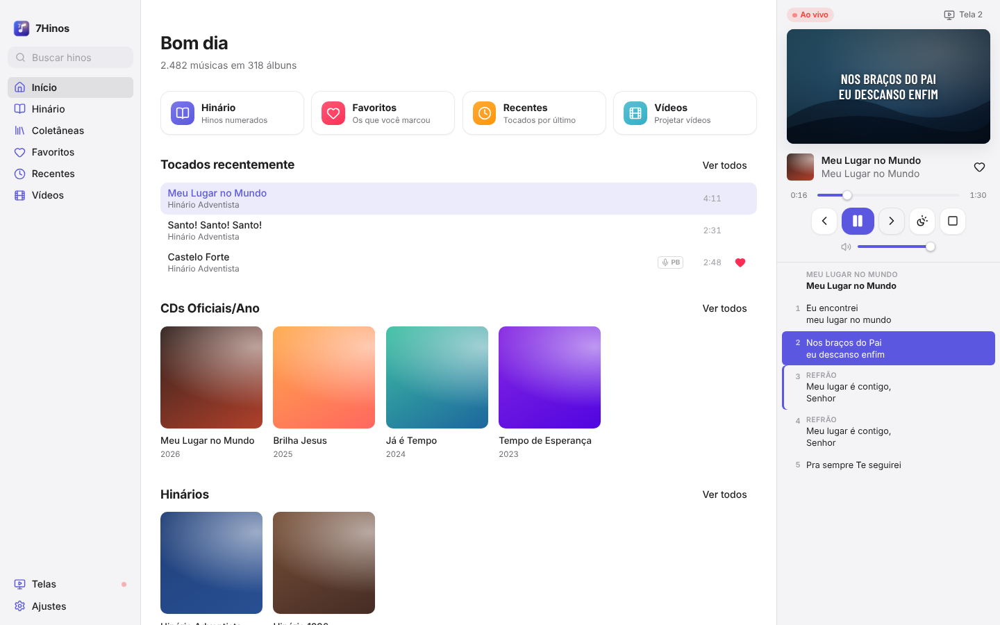
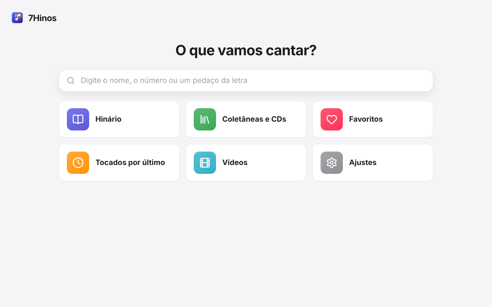
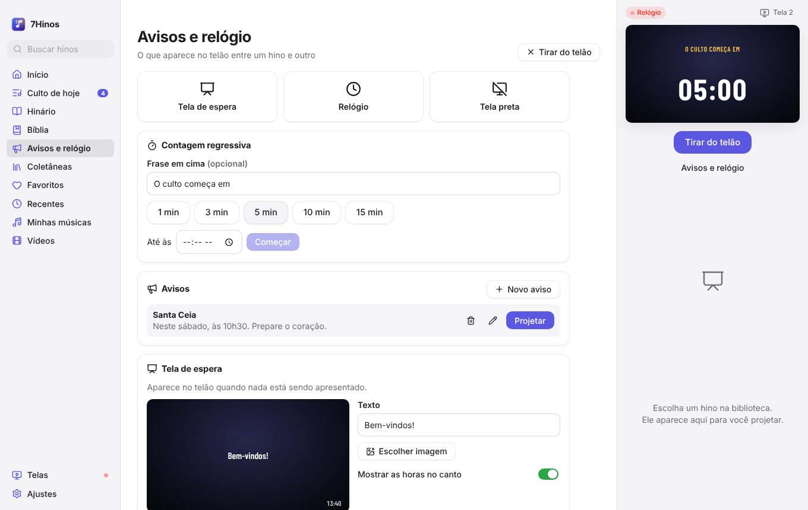
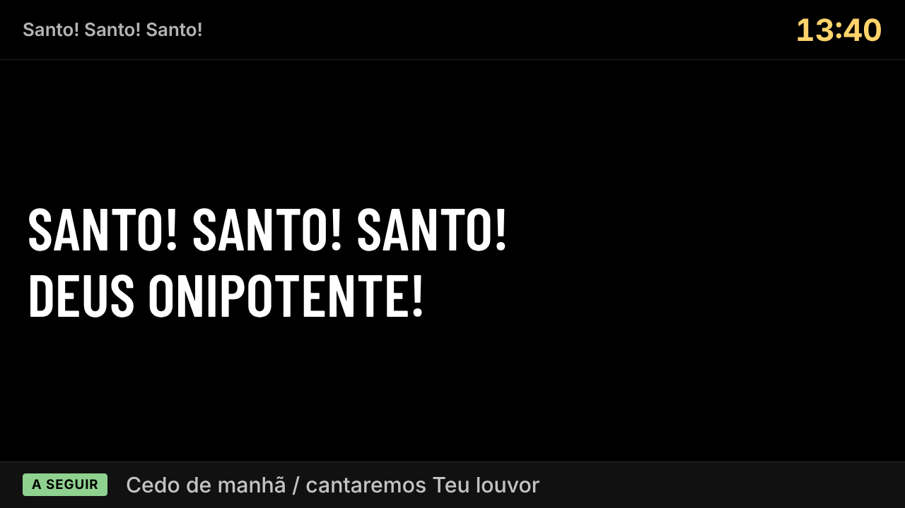

# 7Hinos

Hinos e louvores para o culto: toque com voz ou playback, projete a letra em uma
ou mais telas e exiba vídeos — no Windows, macOS e Linux.

O acervo (letras, áudios, capas e fundos dos slides) é o público do
[LouvorJA](https://louvorja.com.br), baixado da mesma API que os apps oficiais
usam. O 7Hinos não replica o LouvorJA: aproveita o acervo e repensa a
experiência.

| Modo completo | Modo simples |
| --- | --- |
|  |  |
|  |  |
|  |  |

## O que ele faz

- **Dois modos de uso.** O *Simples* tem botões grandes e uma coisa por tela,
  para quem tem pouca prática com computador (idosos, crianças, voluntários
  novos). O *Completo* tem biblioteca, painel de projeção ao lado e atalhos. A
  escolha é feita na primeira abertura e pode ser trocada em Ajustes.
- **Busca que perdoa.** Pelo nome, pelo número do hino ou por um pedaço da
  letra, com ou sem acento. No modo completo, digitar o número em qualquer
  lugar já busca, e `Enter` toca o primeiro resultado: "18", `Enter`, e o
  hino 18 está no telão.
- **Slides sincronizados com a música**, como no LouvorJA, nos modos cantado e
  playback; ou só a letra, passada à mão. Fundo do LouvorJA com sombreamento
  suave (sem tarjas pretas), tipografia condensada que se ajusta sozinha ao
  tamanho da tela e refrão repetido em dourado.
- **Várias telas.** Projeta em qualquer monitor conectado; com projetor ou TV
  ligados, a projeção abre sozinha ao começar um hino. Se o cabo soltar ou o
  projetor desligar, a projeção sai do caminho e volta sozinha quando a tela
  reaparece.
- **Monitor de retorno.** Qualquer tela pode virar o retorno de quem canta ou
  prega: letra grande sem fundo, o próximo slide e as horas. Só ali aparecem
  o **recado do operador** ("Faltam 5 minutos") e o **cronômetro do
  pregador**, em vermelho com "Faltam" e "Passou" quando estoura o tempo
  combinado. A igreja não vê nada disso. Dá para esconder a próxima letra,
  as horas ou o título, mostrar o fundo do telão e mudar o tamanho da letra,
  em **Telas**. Avisos, tela de espera, relógio e sorteio aparecem no retorno
  como no telão. O cronômetro aceita qualquer tempo (e ±1 minuto com ele
  andando), e o recado tem letra e cores à escolha.
- **Telas difíceis.** Telão e retorno também abrem em janela, para telas que
  o sistema não lista direito (alguns adaptadores USB para HDMI): arraste
  para a tela e dê dois cliques. **Identificar telas** mostra o nome de cada
  uma nela mesma.
- **Perfis de telas.** Salve combinações ("Culto normal": telão + retorno;
  "Só retorno") e troque com um clique; o perfil com estrela abre sozinho
  quando o app começa. Cada tela confere sozinha se está em dia com o
  controle e se corrige; se alguma travar, **Reabrir telas** fecha e abre
  todas nos mesmos lugares, sem parar o vídeo.
- **Avisos, relógio e tela de espera.** Avisos da semana salvos para projetar
  com um clique, relógio, contagem regressiva ("O culto começa em 05:00") e
  uma tela de espera com o logo e o nome da igreja — com letra, cores (prontas
  ou qualquer uma, no seletor) e fundo: degradês circulares, cor lisa,
  degradê personalizado ou imagem.
- **Sorteio.** Números (de… até…) ou uma lista de nomes, sem repetir quem já
  saiu, com suspense no telão e a lista dos sorteados.
- **Bíblia.** As versões do LouvorJA (em português e espanhol), busca
  por referência ("jo 3 16", "Salmos 23:1-4") ou por palavra, versículo a
  versículo no telão. Vem do LouvorJA desktop ou é baixada uma vez.
- **Apresentações.** O PDF do pregador (ou fotos) vira slides no próprio
  7Hinos, com setas e passador, sem abrir outro programa. Do PowerPoint: salve
  como PDF (ou instale o LibreOffice para importar direto). Durante a
  apresentação: **zoom** na tela inteira (um PDF em pé cresce para os lados),
  **Ajustar à largura** com rolagem pela roda do mouse, **mão** para mover,
  barras de rolagem na prévia, **foco** (o resto escurece), **marca-texto**,
  **caneta**, **laser** e borracha, que aparecem ao vivo no telão, e
  transições entre páginas (suave, deslizar, aproximar). Cada apresentação
  reabre na página onde parou. A **Lição da Escola Sabatina** do trimestre é
  baixada e aberta da mesma forma — uma por uma ou todas de uma vez — e o app
  lembra onde a classe parou na semana anterior.
- **Controle pelo celular.** Pelo Wi‑Fi da igreja, sem internet: passar
  slides e páginas, tela preta, abrir um hino pelo número ou um item do culto.
  Em **Ajustes → Controle pelo celular**, é só ler o QR code.
- **Fontes.** Mais de vinte fontes livres embutidas (muitas com serifa:
  Garamond, Baskerville, Cinzel…), as instaladas no computador e arquivos
  `.ttf`/`.otf`, escolhidas num menu com a prévia de cada uma. Hinos, Bíblia,
  avisos e recado do púlpito podem ter fontes diferentes.
- **Músicas da igreja.** Cadastre corinhos e hinos que não estão no acervo
  (com áudio e fundo, se quiser) ou corrija a letra de um hino; nenhuma
  atualização apaga o que a igreja fez.
- **Vídeos em uma ou mais telas**, sincronizados entre si, com pausa, avanço,
  repetição e volume. Só a primeira tela toca o som. Formatos que não tocam
  (AVI, WMV, MPG…) são avisados ao adicionar, com a dica de converter.
  Cada vídeo pode ter um tipo (abertura, anúncio, alerta); o **Informativo
  Mundial das Missões** e o **Provai e Vede** da semana ganham botão próprio,
  e o vídeo novo substitui o da semana anterior. No culto de hoje, "Informativo
  de hoje" toca sempre o vídeo da semana. Com um vídeo no ar, o hino escolhido
  pode entrar **depois do vídeo**, sozinho, ou na hora.
- **Funciona sem internet.** Importa o LouvorJA desktop instalado no
  computador (ou copiado num pendrive): hinos, letras, fundos, músicas e
  Bíblia, sem baixar nada. Com internet, os hinos tocados ficam guardados e
  álbuns inteiros (ou o acervo todo) podem ser baixados com um clique; cada
  hino mostra se já está pronto para tocar sem internet.
- **Pacote de pendrive.** Em casa, com internet, **Ajustes → Levar para outro
  computador** grava num pendrive o acervo, as músicas baixadas, a Bíblia, as
  músicas da igreja, os vídeos, os avisos e o culto montado. Na igreja, o
  mesmo botão (ou a primeira abertura) importa tudo.
- **Traz tudo da versão anterior.** Favoritos, vídeos, tema e as músicas já
  baixadas pela versão antiga do 7Hinos são migrados na primeira abertura.
- **Culto de hoje e liturgia.** Monte antes a ordem dos hinos, vídeos,
  apresentações e momentos (oração, leitura, sermão…) — ou comece por um
  modelo (Culto divino, Escola Sabatina, Culto jovem). Cada item aceita uma
  anotação ("Pr. Silva"); um momento com tempo liga o cronômetro do púlpito
  ao começar. Na hora, o painel mostra sempre o próximo; clique duplo num
  hino troca na hora, mesmo com outro tocando.
- **Novidades.** Depois de cada atualização, o app avisa e mostra o que mudou
  (também em **Ajustes → Sobre → Novidades**).
- **Sempre em dia com o LouvorJA.** O acervo é conferido ao abrir e a cada
  3 horas; sem internet, tenta de novo sozinho (1, 5, 15, 30 e 60 minutos) e
  confere na hora em que a conexão volta. O app também baixa novas versões
  dele mesmo em segundo plano, pedindo só para reiniciar.
- **Começar do zero.** **Ajustes → Sobre → Apagar tudo** limpa o que o
  7Hinos guardou e abre como na primeira vez.
- **Erros que não derrubam o culto.** Uma parte da tela que falhar mostra um
  aviso só ali (no telão, fica preta); tudo vai para um arquivo de registro, e
  **Ajustes → Sobre** copia um diagnóstico pronto para pedir ajuda.

### Atalhos (modo completo)

| Tecla | Ação |
| --- | --- |
| `→` `↓` `PageDown` | Próximo slide |
| `←` `↑` `PageUp` | Slide anterior |
| `Espaço` | Pausar / continuar a música |
| `B` ou `.` | Tela preta (e de volta) |
| `/` ou `Ctrl/⌘ F` | Buscar |

As mesmas teclas passam os versículos da Bíblia, e `B` também escurece um
aviso no ar.

`PageUp`, `PageDown`, `B` e `.` são as teclas que os passadores de slide sem fio
enviam, então eles funcionam sem configuração.

## Desenvolvimento

Requisitos: [Node.js 22+](https://nodejs.org), [Rust estável](https://rustup.rs)
e as [dependências do Tauri](https://tauri.app/start/prerequisites/) do seu
sistema (no Linux, `libwebkit2gtk-4.1-dev`).

```bash
npm install
npm run tauri dev      # o app de verdade, com recarga automática
npm run dev:mock       # só a interface, no navegador, com dados simulados
```

`dev:mock` não precisa de Rust nem de internet: abre em `http://localhost:1420`
com um backend falso (`src/dev/mock.ts`). Parâmetros úteis na URL: `?mode=simple`,
`?theme=dark`, `?outputs=1`, `?onboarded=0&installed=0` e `?window=output-1`
(a tela de projeção).

Verificações (as mesmas da CI):

```bash
npm run check && npm test                                  # interface
cd src-tauri && cargo fmt --check && cargo clippy --all-targets -- -D warnings && cargo test
```

Para testar contra outro servidor (por exemplo, uma cópia local da API), defina
`SETEHINOS_API_URL` antes de abrir o app.

## Arquitetura

Poucas peças, cada uma com uma responsabilidade:

```
src-tauri/src/            Rust: dados, disco, rede e janelas
  catalog/
    raw.rs                formato público do LouvorJA (leitura tolerante)
    model.rs              o catálogo como o app entende (músicas, slides…)
    search.rs             busca sem acento, por número e por trecho da letra
    store.rs              catálogo em disco + instalação atômica do pacote ZIP
    remote.rs             cliente da API do LouvorJA
    louvorja.rs           importação do LouvorJA desktop (SQLite → catálogo)
  library.rs              fachada: junta disco, API e cache de mídia
  bible.rs                Bíblia em SQLite (do LouvorJA desktop ou da API)
  user_songs.rs           músicas da igreja e letras corrigidas
  package.rs              pacote de pendrive (exportar e importar)
  downloads.rs            downloads em segundo plano, canceláveis
  legacy.rs               migração da versão anterior (Avalonia)
  media.rs                cache de áudios e imagens (espelha as URLs no disco)
  media_server.rs         entrega arquivos locais à interface (HTTP em 127.0.0.1)
  stage.rs                o palco: o que está sendo projetado agora
  displays.rs             monitores, telão/retorno e reconexão de telas
  decks.rs                apresentações (páginas em imagem; PDF via pdf.js)
  lessons.rs              Lição da Escola Sabatina (API do Sabbath School)
  remote.rs               controle pelo celular na rede local
  fonts.rs                fontes instaladas no computador
  settings.rs             preferências (JSON legível, alteradas por partes)
  updates.rs              vigia que mantém o acervo em dia com o LouvorJA
  contract.rs             testes contra o LouvorJA real (diários, na CI)
  commands.rs             a fronteira com a interface (comandos finos)

src/                      Svelte 5 + TypeScript: só interface
  lib/api.ts              única porta para o backend (comandos e eventos)
  lib/state/*.svelte.ts   estado da interface (player, telas, vídeo, catálogo…)
  lib/slides.ts           sincronia e tamanho do texto (funções puras, testadas)
  components/             peças visuais (SceneView, SlideView, MonitorView…)
  views/                  páginas compartilhadas pelos dois modos
  shell/                  as "cascas" do modo completo e do simples
  windows/                janela de controle, boas-vindas e tela de projeção
```

Decisões que valem lembrar:

- **Um único dono do palco.** O estado da projeção vive no Rust (`stage.rs`).
  A janela de controle pede mudanças; as telas só desenham o que recebem. Uma
  tela aberta no meio do culto pergunta o estado e entra sincronizada.
- **O áudio toca na janela de controle**, que decide o slide pelo tempo da
  música e o envia ao palco. Vídeos tocam em cada tela escolhida, alinhados
  pelo relógio (`posição + tempo decorrido`), corrigindo só desvios visíveis.
- **Arquivos locais por HTTP.** O WebView do Linux não toca áudio e vídeo pelo
  protocolo próprio do Tauri; um servidor mínimo em `127.0.0.1`, com token
  aleatório e lista de pastas liberadas, entrega os arquivos igual em todo
  sistema (com `Range`, para avançar a música).
- **Mídia sem índice.** Cada URL tem um caminho fixo no disco; um arquivo
  existe ou não. Downloads gravam em `.part` e renomeiam no fim.
- **Instalação atômica do catálogo.** O pacote é extraído ao lado e só troca
  o atual se estiver completo — um download ruim nunca estraga o que funciona.
- **O retorno desenha o mesmo palco.** Cada cena de slide leva também o
  slide seguinte; o telão o ignora, o retorno mostra embaixo.
- **Telas que somem.** Um vigia confere os monitores a cada 2 segundos. Se um
  monitor com projeção sumir, a janela é fechada (no Windows ela cairia por
  cima do controle) e reaberta na mesma tela, ou numa tela externa nova,
  quando ela voltar.
- **Erros escritos para pessoas.** Mensagens do backend chegam prontas para
  aparecer na tela.

### Sem internet: o LouvorJA desktop

O LouvorJA para Windows guarda tudo numa pasta (normalmente
`C:\Program Files (x86)\Louvor JA`):

```
config/pt_database.db        (database.db nas versões antigas)
config/musicas/<álbum>/      áudios
config/imagens/              fundos dos slides
config/capas/                capas dos álbuns
```

`catalog/louvorja.rs` lê o banco (o mesmo esquema que a API deles gera para o
programa) e o converte para o formato do acervo online, apontando para os
endereços que o acervo online usaria. As três pastas viram fontes locais do
cache de mídia (`media.rs`), que procura o arquivo nelas antes de ir à
internet — aceitando MP3 no lugar de Opus e BMP no lugar de JPG. Por isso
tudo funciona offline, e se um dia o acervo online for baixado por cima, os
arquivos locais continuam sendo usados.

A importação aparece na primeira abertura (se o LouvorJA for encontrado ou se
não houver internet) e em **Ajustes → Hinos**. Pastas extras com músicas
organizadas por álbum podem ser adicionadas em **Ajustes → Sem internet**.

### De onde vêm os hinos

| Endereço | Para quê |
| --- | --- |
| `api.louvorja.com.br/json_db/config` | versão do acervo publicado |
| `api.louvorja.com.br/db/catalog-bundle` | ZIP com o acervo inteiro (sem a Bíblia) |
| `api.louvorja.com.br/json_db/{chave}` | uma música ou álbum avulso, quando falta no disco |
| `files.louvorja.com.br/...` | áudios (MP3/Opus), capas e fundos |

São as rotas documentadas em
[louvorja/api-workers](https://github.com/louvorja/api-workers). A atualização
compara a versão local com a publicada e baixa o pacote só quando há novidade.

## Acompanhando o LouvorJA

O workflow **Contrato LouvorJA** roda todo dia contra o LouvorJA de verdade:
baixa o acervo online e o banco do programa desktop, confere coleções,
hinários, letras, tempos dos slides, áudios e capas, e compara o banco
desktop com o acervo online. Se o LouvorJA mudar algo que o 7Hinos não
entende, o workflow falha e abre uma issue — antes que alguém perceba no culto.

Para rodar na sua máquina: `cd src-tauri && cargo test contract -- --ignored --nocapture`.

## Instaladores de teste

O workflow **Instaladores** gera uma pré-release com os instaladores das três
plataformas a partir de qualquer branch: rode-o em *Actions → Instaladores →
Run workflow* ou inclua `[instaladores]` na mensagem do commit.

- **Windows**: o `_x64-setup.exe` é pequeno e só baixa o WebView2 se o
  computador não tiver (o Windows 11 e o 10 atualizado já têm). Para um
  computador sem internet que nunca teve o WebView2, há o
  `_x64-offline-setup.exe`, com ele embutido. O instalador é em português, com
  a identidade do app (imagens em `src-tauri/icons/installer/`).
- **macOS**: app universal (Intel e Apple Silicon), sem assinatura da Apple.
  Na primeira vez: botão direito → *Abrir*.

## Publicando versões

Commits seguem [Conventional Commits](https://www.conventionalcommits.org/pt-br/).
O [release-please](https://github.com/googleapis/release-please) abre um PR de
versão; ao fazer o merge, a CI gera os instaladores de Windows (`.msi`/`.exe`),
macOS (Apple Silicon e Intel) e Linux (`.deb`, `.rpm`, `.AppImage`) e os anexa à
release no GitHub.

### Atualização automática

O app só aceita atualizações assinadas com a chave do projeto. A chave
pública já está em `plugins.updater.pubkey` (`src-tauri/tauri.conf.json`); a
privada fica nos *secrets* do repositório (`TAURI_SIGNING_PRIVATE_KEY` e, se
tiver senha, `TAURI_SIGNING_PRIVATE_KEY_PASSWORD`), e o workflow de release a
usa para assinar.

Guarde uma cópia da chave privada (`~/.tauri/7hinos.key`) fora do GitHub:
sem ela, quem já instalou não recebe novas versões. Se um dia precisar de
outra, gere com `npx tauri signer generate -w ~/.tauri/7hinos.key` e troque
as duas pontas — quem tem a versão antiga precisará instalar a nova à mão.

## Observações

- No Linux, tocar áudios Opus depende dos plugins do GStreamer
  (`gstreamer1.0-plugins-good`), normalmente já instalados.
- Acervo, letras e mídias pertencem ao LouvorJA e seus autores. O 7Hinos só os
  consome pela API pública.
